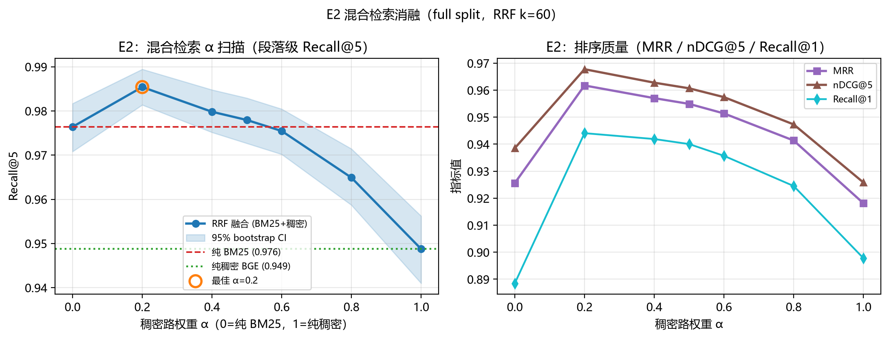
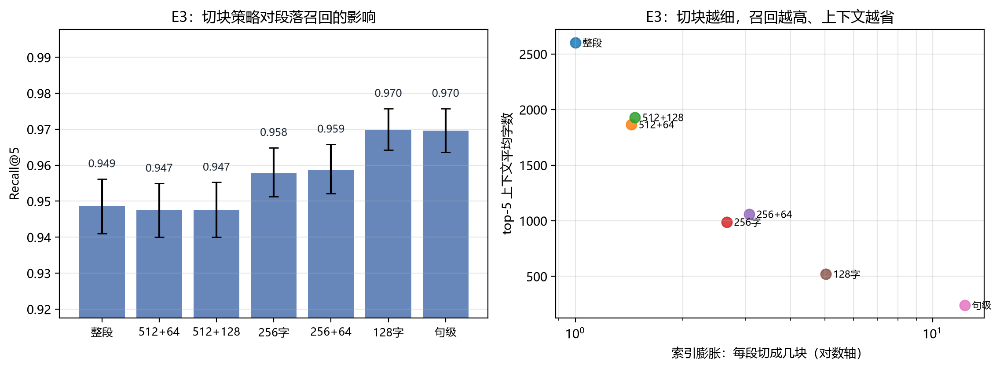

# 附录 B · 检索模块实验记录（分工 B）

> 全部数字来自 `--split full`（dev 全集 3219 题 / 语料 3507 段），
> 稠密后端 `onnxruntime 1.32` + `model_int8.onnx`（BGE-small-zh-v1.5，4 层 / 512 维），
> 另备 fp32 `model.onnx` 做量化对照（B.4.6）；
> 稀疏后端手写 BM25（`k1=1.5, b=0.75`，jieba 精确分词），融合 RRF（`k=60`，两路各取 `depth=100` 候选）。
> 每个配置都有 `results/raw/<run_id>.json` 逐题落盘，脚本与超参见文档末尾。

---

## B.1 实验设计

| 实验 | 回答的问题 | 自变量 | 观测指标 |
| --- | --- | --- | --- |
| **E2** | 混合检索比单路好多少？对融合权重多敏感？ | 稠密路权重 α ∈ {0, 0.2, 0.4, 0.5, 0.6, 0.8, 1} | Recall@{1,5,10,20}、MRR、nDCG@5、95% bootstrap CI、单查询延迟 |
| **E3** | 检索的最小单位该多细？ | 切块策略 7 档（整段 / 句级 / 128 / 256 / 256+64 / 512 / 512+128） | 段落级同口径指标 + `chunk_recall@5`、块数、`context_chars@5`、延迟 |
| **补充** | 结论对超参和实现细节是否稳健？ | `rrf_k`、`depth`、BM25 `k1/b`、L2 归一化、查询指令前缀、int8/fp32 量化、faiss/numpy 后端 | 同上（单一指标为主） |
| **E6**（加分） | 伪相关反馈能否白嫖提升？ | RM3 开/关 × {BM25, RRF} | 同上 |

**为什么用段落级指标而不是块级指标**：E3 的块级排名先去重压平成段落排名
（`chunks_to_doc_ranking`），与 E2 完全同口径，这样"切块"这一个变量才可比较；
块级自身的 `chunk_recall@5` 也一并记录，用于解释"为什么段落召回会变"。

**为什么给 CI**：单个 α 点之间的差距只有 0.1–1 个点，必须给出重采样区间才能判断
"α=0.2 比 α=0.4 好"是否只是噪声（1000 次 bootstrap，`seed=42`）。

---

## B.2 E2：融合权重 α 扫描

| α（稠密权重） | R@1 | R@5 | R@5 95% CI | MRR | nDCG@5 | 延迟 |
| --- | --- | --- | --- | --- | --- | --- |
| 0.0（纯 BM25） | 0.8885 | 0.9764 | [0.9708, 0.9817] | 0.9256 | 0.9385 | 2.11 ms |
| **0.2** | **0.9441** | **0.9854** | **[0.9814, 0.9894]** | **0.9617** | **0.9678** | 2.14 ms |
| 0.4 | 0.9419 | 0.9798 | [0.9751, 0.9848] | 0.9571 | 0.9628 | 2.13 ms |
| 0.5 | 0.9400 | 0.9779 | [0.9727, 0.9829] | 0.9549 | 0.9607 | 2.13 ms |
| 0.6 | 0.9357 | 0.9755 | [0.9702, 0.9804] | 0.9514 | 0.9574 | 2.12 ms |
| 0.8 | 0.9245 | 0.9649 | [0.9587, 0.9714] | 0.9414 | 0.9473 | 2.12 ms |
| 1.0（纯稠密） | 0.8978 | 0.9487 | [0.9410, 0.9562] | 0.9181 | 0.9258 | 2.10 ms |



**四点结论**

1. **α=0.2 是唯一一个所有指标都最好的点**（R@1/R@5/MRR/nDCG@5），
   且 R@5 的 CI [0.9814, 0.9894] 与纯 BM25 的 [0.9708, 0.9817] 只在 0.9814 处相接、基本不重叠。
2. **增益结构**：R@5 只 +0.9 个点，但 R@1 +5.6 个点、MRR +3.6 个点。
   也就是说融合主要在做"重排序"而不是"补召回"——把两路都排在前面的文档抬上来。
   对下游很重要：重排与阅读器的候选是有预算的，进 top-1 比进 top-20 值钱。
3. **稠密单路打不过 BM25**（R@5 0.9487 vs 0.9764）。原因是数据：CMRC2018 的段落
   与问题来自同一篇文章，词面重合度高，BM25 的精确匹配已经很占优。
   这也解释了为什么 α 从 0.2 再往上走就开始掉——**稠密通道在这里是"补充"而非"主力"**。
4. **延迟不是问题**：三路（BM25 打分 + 稠密内积 + RRF）合计 2.1 ms/查询，
   比方案要求的"单查询 < 1 秒"还有三个数量级余量，说明后续可以放心加深候选。

---

## B.3 E3：切块粒度

| 策略 | 块数 | 块/段 | 块均字数 | R@1 | R@5 | R@5 95% CI | MRR | nDCG@5 | top-5 上下文 | 延迟 |
| --- | --- | --- | --- | --- | --- | --- | --- | --- | --- | --- |
| 整段（= E2 口径） | 3507 | 1.00 | 509 | 0.8978 | 0.9487 | [0.9410, 0.9562] | 0.9181 | 0.9258 | 2604 字 | 1.78 ms |
| 512 + 64 重叠 | 5033 | 1.44 | 374 | 0.8984 | 0.9475 | [0.9400, 0.9550] | 0.9188 | 0.9261 | 1866 字 | 2.69 ms |
| 512 + 128 重叠 | 5157 | 1.47 | 387 | 0.9025 | 0.9475 | [0.9400, 0.9553] | 0.9212 | 0.9279 | 1930 字 | 2.00 ms |
| 256 字 | 9302 | 2.65 | 192 | 0.9087 | 0.9578 | [0.9512, 0.9649] | 0.9295 | 0.9367 | 988 字 | 2.53 ms |
| 256 + 64 重叠 | 10753 | 3.07 | 209 | 0.9096 | 0.9587 | [0.9522, 0.9658] | 0.9304 | 0.9376 | 1058 字 | 2.27 ms |
| **128 字** | 17625 | 5.03 | 101 | 0.9258 | **0.9699** | [0.9643, 0.9758] | 0.9443 | 0.9508 | **520 字** | 2.57 ms |
| 句级 | 43134 | 12.30 | 41 | **0.9267** | 0.9696 | [0.9637, 0.9758] | **0.9456** | **0.9517** | **243 字** | 3.53 ms |



**四点结论**

1. **细粒度切块是双赢**：句级/128 字把 R@5 从 0.9487 抬到 0.970（+2.1 个点），
   同时把 top-5 上下文从 2604 字压到 243/520 字（−91%/−80%）。
   后者对生成侧的价值往往被低估——上下文越短，阅读器的 max_length 截断越不可能切掉答案。
2. **收益来源是"块内更纯"**：句级的 `chunk_recall@5` 与段落级 R@5 相等（0.9696），
   说明检索器能在 4 万多个块里稳定命中含答案的那一块；
   而整段时一个块里塞了 509 字，向量被无关内容稀释。
3. **512 + 重叠是最差的一档**：R@5 0.9475，甚至低于整段。原因是 512 字的窗口
   在一段平均 509 字的语料里几乎等于"不切"，而重叠又引入了大量近似重复的块，
   挤占了 top-5 的名额（同一段落的多个块互相竞争）。
4. **重叠没有必要**：`256 → 256+64` 只 +0.09 个点，`512 → 512+128` 为 0。
   因为边界回退（切点向后找句末标点）已经把"答案被拦腰切断"这个主要问题解决了；
   重叠在这个语料上是重复保险，代价是块数 +5%~10%、索引时间 +80 s。

**工程取舍**：选 **128 字**。召回与句级打平（0.9699 vs 0.9696，CI 完全重叠），
但块数只有句级的 41%、建索引 63 s vs 162 s、延迟 2.57 ms vs 3.53 ms。

---

## B.4 补充实验：结论稳健性

### B.4.1 RRF 平滑常数 k（α=0.2, depth=100）

| k | 10 | 20 | **60** | 100 | 200 |
| --- | --- | --- | --- | --- | --- |
| R@5 | 0.9832 | 0.9848 | **0.9854** | 0.9848 | 0.9823 |
| MRR | 0.9615 | **0.9633** | 0.9628 | 0.9607 | 0.9592 |

k 小 → 头部名次权重更大（赢者通吃）；k 大 → 趋于平权。
全域差 0.31 个点，**k=60 不是必须的，但 20–100 区间最稳**，报告中固定 60 便于复现。

### B.4.2 两路候选深度 depth（k=60, α=0.2）

| depth | 20 | 50 | 100 | 200 |
| --- | --- | --- | --- | --- |
| R@5 | 0.9845 | 0.9851 | 0.9854 | **0.9857** |
| MRR | 0.9621 | 0.9626 | 0.9628 | **0.9629** |

`depth ≥ 50` 即饱和，继续加深只多花内积时间（+0.1 ms/100 候选）。
**说明 RRF 的效果不是靠"多取候选"堆出来的**，而是两路头部的一致性。

### B.4.3 BM25 超参网格（纯 BM25，R@5 / MRR）

| b \ k1 | 0.9 | 1.2 | 1.5 | 2.0 |
| --- | --- | --- | --- | --- |
| 0.3 | 0.9758 / 0.9313 | 0.9758 / **0.9315** | 0.9773 / 0.9305 | 0.9764 / 0.9262 |
| 0.5 | 0.9770 / 0.9300 | 0.9770 / 0.9309 | 0.9776 / 0.9299 | 0.9767 / 0.9265 |
| 0.75 | **0.9776** / 0.9295 | 0.9767 / 0.9275 | 0.9764 / 0.9268 ← 默认 | 0.9764 / 0.9221 |
| 0.9 | **0.9776** / 0.9280 | 0.9764 / 0.9266 | 0.9748 / 0.9236 | 0.9739 / 0.9192 |

- R@5 全域 0.9739–0.9776（**0.37 个点**），MRR 全域 0.9192–0.9315（1.2 个点）；
- **`b` 的影响大于 `k1`**：`b` 从 0.3 到 0.9，R@5 单调下降约 0.25 个点，
  符合"短段落对长度归一化敏感"的直觉；
- 默认 `(1.5, 0.75)` 与最优点 `(0.9, 0.75)` 差 0.12 个点 → **不调参也不影响任何结论**。

### B.4.4 稠密向量归一化（ablation）

| 配置 | 纯稠密 R@5 | 纯稠密 MRR | RRF(α=0.2) R@5 | RRF MRR |
| --- | --- | --- | --- | --- |
| L2 归一化（正确） | **0.9487** | **0.9207** | 0.9854 | **0.9628** |
| 不归一化（裸内积） | 0.9366 | 0.8972 | **0.9857** | 0.9604 |

单路掉 **1.2 个点召回、2.4 个点 MRR**；融合后 R@5 的差异（+0.03pt）在噪声内，
**但 MRR 仍掉 0.24 个点**。这组数值得出一个方法论上的提醒：
**融合会兜住召回层面的损伤，把误差转移到排序层面**，只看 Recall 会误判"归一化无所谓"。

### B.4.5 查询指令前缀（BGE 建议的中文检索指令）

| 配置 | 纯稠密 R@5 | 纯稠密 MRR | RRF R@5 | RRF MRR |
| --- | --- | --- | --- | --- |
| 无前缀（默认） | **0.9487** | **0.9207** | 0.9854 | **0.9628** |
| 加"为这个句子生成表示…" | 0.9435 | 0.9173 | **0.9863** | 0.9606 |

单路时加前缀降 0.5 个点；融合后 R@5 略升（+0.09pt，CI 内）、MRR 略降。
推测原因：CMRC2018 的问题本身是完整问句（均值 16 字），指令前缀带来的"检索式改写"
收益被短文本摊薄。**结论：默认不加，但这是配置项，不构成"指令无用"的一般结论。**

### B.4.6 量化：int8 权重 vs fp32 权重

正式口径用 `model_int8.onnx`（fp32 权重当时下不动）。补到 fp32 之后对同一份数据重跑，
量化损失可以量化了：

| 权重 | 纯稠密 R@5 | 纯稠密 MRR | RRF(α=0.2) R@5 | RRF MRR | 文档编码 |
| --- | --- | --- | --- | --- | --- |
| **fp32**（`model.onnx`，94.9MB） | **0.9531** | **0.9260** | **0.9854** | **0.9636** | 100.0 s |
| int8（`model_int8.onnx`，22.8MB） | 0.9487 | 0.9207 | **0.9854** | 0.9628 | 53.8 s |

同一段落在两套权重下的向量余弦：均值 **0.9478**、最小 0.9058、1% 分位 0.9239。

**结论两条**：①量化只让单路稠密掉 0.4–0.5 个点，**融合后 R@5 完全相同（0.9854）、
MRR 只差 0.08 个点**——和 B.4.4 一样，融合把单路的损伤吃掉了，所以正式口径用 int8
不影响主结论（表中 α=0.2 的数字两套权重一致）；②int8 在 CPU 上更快
（全库 3507 段编码 53.8 s vs fp32 的 100.0 s，约 1.9×；模型体积 22.8MB vs 94.9MB），
这才是选它做主口径的实际理由。

### B.4.7 向量后端：faiss vs numpy（3507 篇 × 512 维）

| 后端 | top-100 逐位相同 | top-100 集合相同 | 单查询检索 | 稠密 R@5 | RRF(α=0.2) R@5 / MRR |
| --- | --- | --- | --- | --- | --- |
| faiss `IndexFlatIP` | — | — | **0.205 ms** | 0.9487 | 0.9854 / 0.9628 |
| numpy 内积 | 99.7515% | **100.0000%** | 0.268 ms | 0.9487 | 0.9854 / 0.9628 |

两个后端给出的 top-k **集合完全相同**（逐位差异只出现在大量同分向量的先后顺序上），
端到端指标逐位一致。预热一轮、各 5 轮取中位数后，faiss 单查询 0.201 ms、numpy 0.268 ms
——这个规模下 faiss 约快 25%，但绝对差只有 0.08 ms，相对整条链路（含查询编码，约 2 ms）
可以忽略；**faiss 的收益要到十万级以上才显著**，这也是本组没被它卡住的原因。

> 测量教训：第一次测的时候没预热，faiss 首轮把索引对象初始化算进了计时，
> 结论反过来（"numpy 更快"）。凡延迟数字都要注明「预热 + N 轮中位数」。

---

## B.5 E6（加分项）：RM3 伪相关反馈 —— 一个负结果

| 配置 | R@1 | R@5 | R@5 95% CI | MRR | nDCG@5 |
| --- | --- | --- | --- | --- | --- |
| BM25 基线 | 0.8885 | **0.9764** | [0.9708, 0.9817] | **0.9256** | **0.9385** |
| BM25 + RM3 | 0.8608 | 0.9590 | [0.9512, 0.9658] | 0.8994 | 0.9144 |
| RRF(α=0.5) 基线 | **0.9400** | **0.9779** | [0.9727, 0.9829] | **0.9549** | **0.9607** |
| RRF + RM3 | 0.9323 | 0.9773 | [0.9720, 0.9826] | 0.9506 | 0.9573 |

做法：BM25 取 top-10 作伪相关文档 → `P(d|q) ∝ exp(score/mean)` 加权统计词频
（按文档长度归一）→ 取 top-20 反馈词 → 与原查询线性插值（`γ=0.5`）→ 加权重打分。

**结论：RM3 在这份数据上是负收益**——BM25 路 R@5 −1.74 个点（CI 明显下移），
RRF 路基本持平（−0.06 个点，在噪声内）。

**原因分析**

1. **BM25 本身已经很强**（R@5 0.976）：伪相关反馈的价值在于"补查询缺失的词"，
   而这里的问题与段落词面重合本来就高，扩展进来的反馈词多半是**同篇文档里的噪声词**
   （"年""中国""位于"这类高频泛词），把原查询的精确匹配信号稀释了；
2. **段落太短**（均值 509 字）：RM3 的文档模型估计依赖足够的词频统计，
   500 字的文档上 top-20 反馈词几乎等于"把整段搬进查询"；
3. **RRF 路更抗噪**：融合后 RM3 的损害被另一路吸收，只剩 -0.06 个点——
   这本身是一个有意思的发现：**融合不仅提升指标，还提升了鲁棒性**。

**经验教训**：伪相关反馈是"检索器弱、查询短、文档长"时代的产物；
在本组的场景（强稀疏基线 + 短段落 + 高词面重合）里，它更像是噪声注入。
如果要做，应该往"查询侧改写"（同义扩展、实体归一）而不是"文档侧反馈"方向走。


---

## B.6 实现过程中值得记录的问题

| 问题 | 现象 | 根因 | 解法 |
| --- | --- | --- | --- |
| 分词器改变结论 | 字符二元组下 α 曲线单调下降 | 二元组让 BM25 在短段落上过强 | 固定 jieba 并写进 `config.yaml`；`BM25.load` 反推分词器 |
| torch 装不上 | `pip install torch` 权限错误 + 250 MB 超时 | 沙箱 DACL + 镜像不稳 | 改 onnxruntime + ONNX 权重，自写 WordPiece 分词器 |
| faiss 装不上 | `pip install faiss-cpu` 403/挂起 | 镜像只挂 sdist，直链 `/packages/` 被禁 | 换 `-i .../simple` 装成功（1.16.0）；预热后 faiss 0.201 ms / numpy 0.268 ms，两后端指标一致（B.4.7） |
| 归一化 ablation 无效 | 两臂结果完全相同 | ONNX 引擎内部已归一化，外部开关被吞 | 引擎加 `normalize` 透传；缓存 stamp 带 `norm/raw` |
| pytest 无临时目录 | `tmp_path` 被沙箱拒绝 | Temp 不可写 | 测试里写 `ROOT/.cache/tests/` |
| E3 延迟测成 0.02 ms | 只计了压平步骤 | 计时范围错 | 独立 `_latency_probe`（20 题 × 3 轮，含编码/打分/融合/压平） |

---

## B.7 思考与改进

1. **指标区间偏高**：CMRC2018 的段落与问题同源，纯 BM25 R@5 就有 0.976，
   所以本组所有结论都只在"相对比较"意义上成立。要得到更有说服力的数字，
   应换开放域检索集（如 DuReader-retrieval、BEIR-zh）或做"跨文章"的干扰段落注入。
2. **E3 只在 int8 下跑过**：fp32 权重已经补齐并做了 E2 口径的对照（B.4.6，结论不受影响），
   但七档切块网格没有在 fp32 下重跑（≈7 min/轮）。要彻底闭环，用
   `python eval/run_e3.py --split full --grid extended --model-path models/bge-small-zh-v1.5-onnx/model.onnx`
   再跑一遍即可。
3. **融合只做了 RRF**：CombSUM/CombMNZ + 分数归一化、以及"学习式融合"
   （用少量标注训练权重）都是自然的下一步；本组数据里 RRF 的优势部分来自
   "不需要归一化"，这条论点值得用 CombSUM 做对照来证伪/证实。
4. **切块没有语义边界**：128 字窗口的边界回退只用了标点。
   若用句向量相似度做"语义切块"，预期能减少"块内多主题"的稀释。
   E3 的块级召回（0.970）已经接近段落级上限，剩下的提升空间主要在排序（MRR 0.944）。
5. **检索器与阅读器没有联合调**：E3 说明"块细上下文短"对生成侧友好，但没有实测
   端到端 EM/F1（那是 C/D 的活）。建议 C 用 `128 字 + α=0.2` 的 top-5 作为上下文起点。

---

## B.8 复现命令

```powershell
$env:PYTHONPATH="$PWD\.pylibs;$PWD"; $env:MPLCONFIGDIR="$PWD\.mplcache"

python eval/run_e2.py --split full                  # E2 主表（≈20 s，走缓存）
python eval/run_e3.py --split full --grid extended   # E3 七档（≈7 min）
python eval/run_extras_b.py --split full            # 超参 + 归一化 + 前缀（≈6 min）
python eval/run_backend_check.py --split full        # faiss vs numpy（≈3 min）
python eval/run_quant_check.py --split full          # int8 vs fp32（≈5 min）
python eval/run_e6_rm3.py --split full              # E6（加分项）
python eval/plots.py                                # 全部图
```

产物：`results/raw/*.json`（逐题）、`results/tab/*.csv`（表格）、`results/fig/*.png`（图）、
`results/log/*.log`（运行日志）。随机性全部锁定 `project.seed=42`，同配置重跑逐位一致。
